<div align="center">

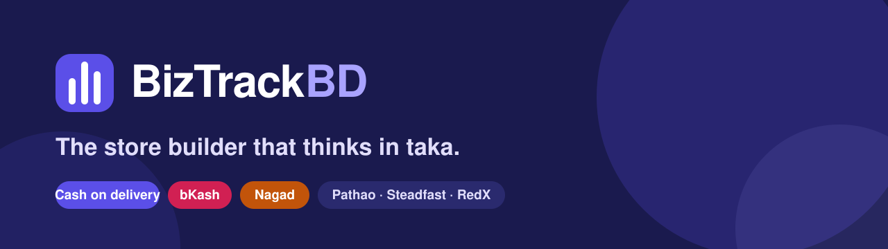

<br />

**A multi-tenant ecommerce platform built for how Bangladesh actually sells.**<br />
Cash on delivery, bKash and Nagad with TrxID checks, Pathao, Steadfast and RedX, fake-order protection, and a store builder that works on a phone.

<br />

[](https://github.com/neiloy-neil/biztrackbd-ecom/actions/workflows/ci.yml)


[Features](#-what-you-get) · [Screenshots](#-see-it) · [Templates](#-six-templates-each-with-a-live-demo) · [Architecture](#-architecture) · [Run it](#-run-it-locally) · [Deploy](#-deploy-it) · [Docs](#-documentation)

</div>

---

## Why this exists

Global store builders are made for card payments and next-day couriers. A shop in Dhaka lives differently:

- Most orders are **cash on delivery**, and the courier pays the merchant weeks later, often short.
- Half the rest are **bKash or Nagad**, where the customer types a TrxID and someone has to check it.
- Orders arrive by **phone and Messenger** as often as through a website.
- **Fake orders** and refused parcels eat the margin.
- Merchants run the whole shop from a **phone**, in **Bangla** as often as English.

BizTrackBD starts from those facts. Everything else follows.

---

## ✨ What you get

<table>
<tr>
<td width="50%" valign="top">

### 🛒 Sell the way customers pay
- Cash on delivery, **manual bKash and Nagad** with TrxID capture, and a one-screen verification desk
- Division → district → upazila address fields that match couriers
- **Bangla and English** storefront, switchable per visitor
- A checkout that holds on 3G, with prices recalculated on the server so a tampered cart cannot change what is charged
- Landing pages for one-product ad campaigns, taking orders by cash on delivery

### 📦 Run operations from one place
- Orders with **live filters, bulk actions and a quick-view drawer**
- Book **Steadfast, Pathao or RedX** from the order, follow each parcel, and check the courier's payout statement for short payments
- **Returns and exchanges** with stock put back and a record of every step
- A **delivery trust score** per phone number, built from parcels across stores, holding risky cash orders until you have called
- Profit that adds up: sales minus product cost, courier fees, returns, refunds and ads

</td>
<td width="50%" valign="top">

### 🎨 Design a store without a designer
- **Six templates**, each with a live demo: Kapor, Gadget Studio, Mini Bunny, Axion Wear, Bindu and Berber
- A **full-screen page builder**: sections list, live preview of the real store, settings panel, undo and redo, drag to reorder, click a section in the preview to edit it
- Edit the **home, product, collection and cart pages**, with draft, publish, version history and one-click rollback
- Works on a phone: the preview on top, a tabbed panel below

### 📈 Grow
- Loyalty points, VIP tiers and referrals that cannot be farmed
- Abandoned-checkout recovery by SMS
- Meta Pixel and Conversions API (server-side, deduplicated), Google Analytics 4
- Coupons, discounts, reviews with owner replies

### 🏢 Run a platform, not just a store
- Sign-up in minutes with a **14-day trial**, plans in taka, payment by bKash or Nagad with proof
- Platform admin: approve payments, manage plans and limits, suspend or reactivate stores, audit every action
- Custom domains with automatic verification and SSL

</td>
</tr>
</table>

---

## 📸 See it

<table>
<tr>
<td width="50%">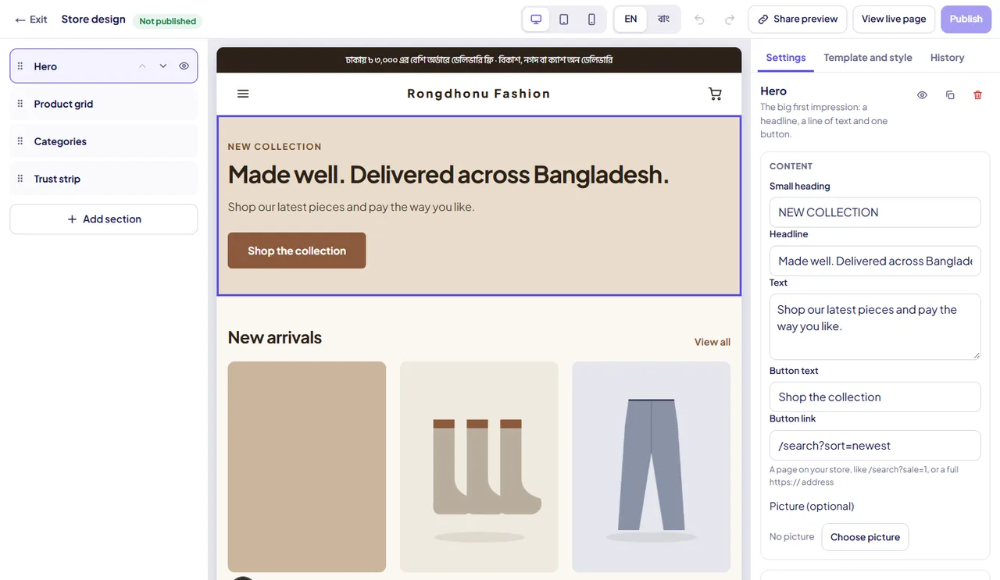<br /><sub><b>Store builder.</b> Live preview of the real store, grouped settings, undo and redo.</sub></td>
<td width="50%">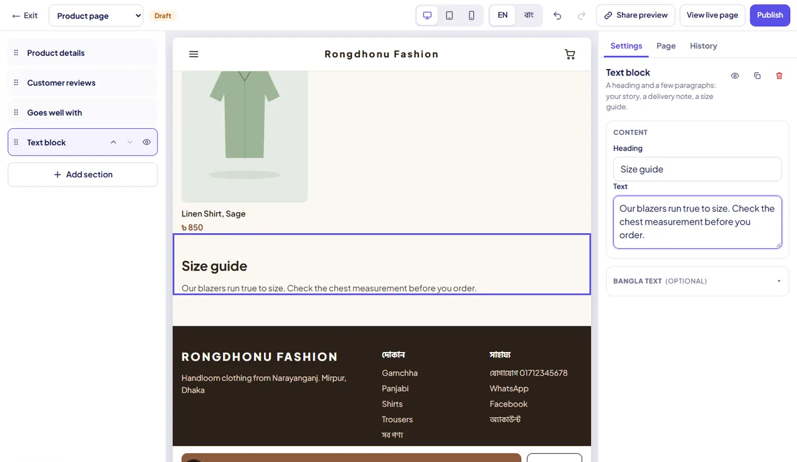<br /><sub><b>Product page layout.</b> The product block is fixed; everything around it is yours.</sub></td>
</tr>
<tr>
<td width="50%">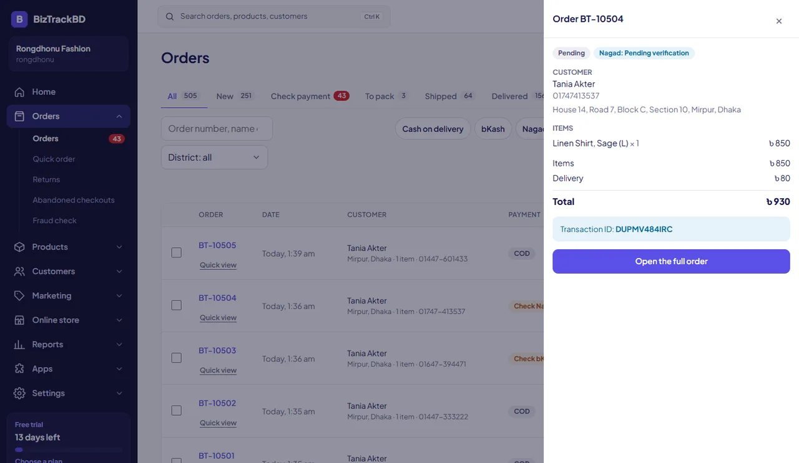<br /><sub><b>Orders.</b> Filters apply as you type; quick view opens beside the list.</sub></td>
<td width="50%">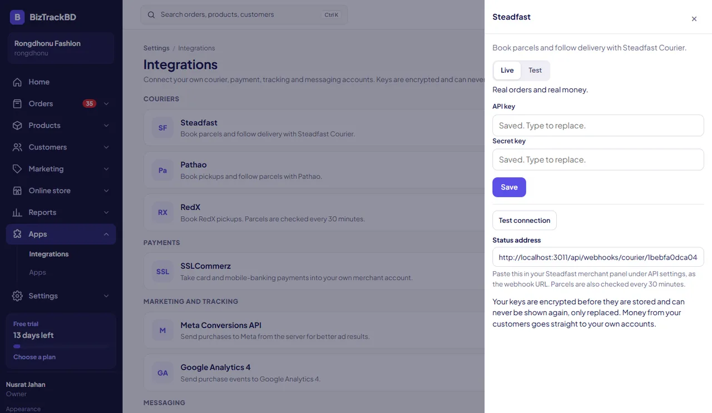<br /><sub><b>Integrations.</b> Your own courier and payment keys, encrypted, write-only.</sub></td>
</tr>
</table>

<p align="center">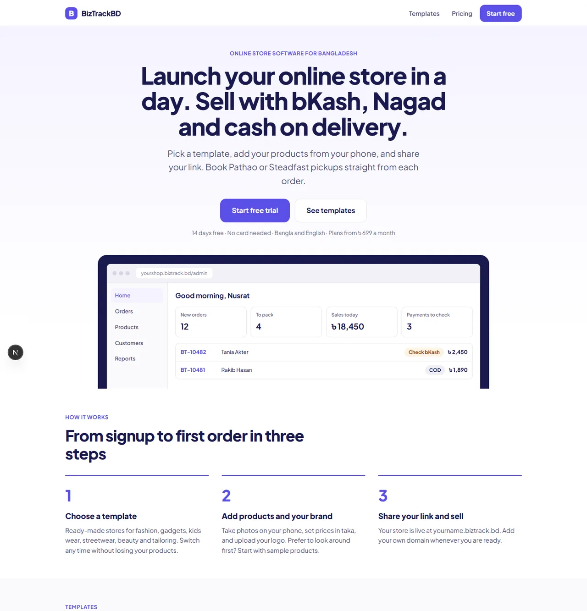<br /><sub><b>The marketing site</b> at the top of the funnel: template previews, pricing and a trial in one click.</sub></p>

---

## 🎭 Six templates, each with a live demo

Every template is a complete store with its own look, products in English and Bangla, and generated illustrations (no stock-photo licences). Demo stores refuse real orders and rebuild themselves every night.

<table>
<tr>
<td align="center" width="33%">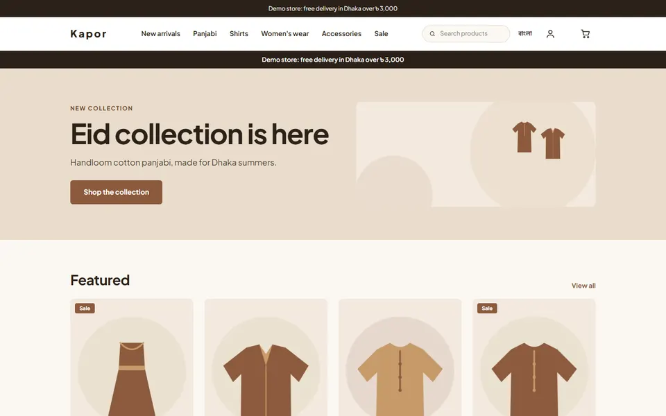<br /><b>Kapor</b><br /><sub>Warm, editorial fashion</sub></td>
<td align="center" width="33%">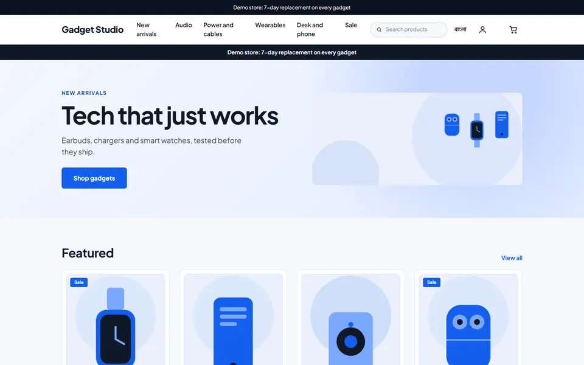<br /><b>Gadget Studio</b><br /><sub>Crisp tech and accessories</sub></td>
<td align="center" width="33%">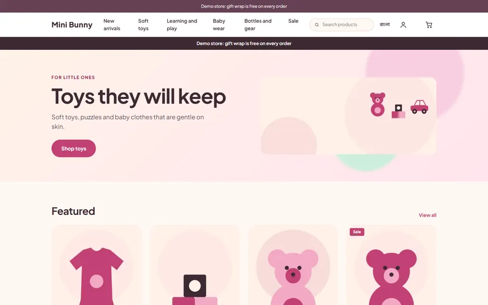<br /><b>Mini Bunny</b><br /><sub>Playful kids and gifts</sub></td>
</tr>
<tr>
<td align="center">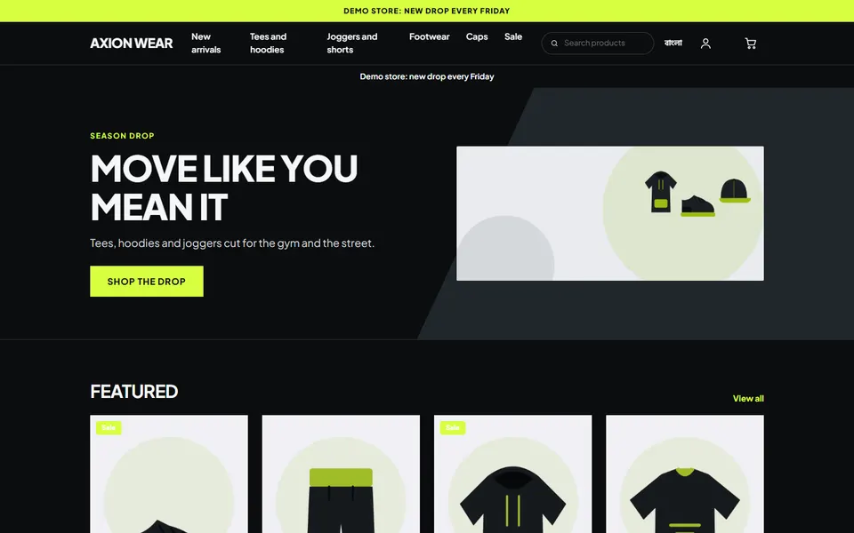<br /><b>Axion Wear</b><br /><sub>Dark, high-contrast streetwear</sub></td>
<td align="center"><br /><b>Bindu</b><br /><sub>Calm, premium beauty</sub></td>
<td align="center">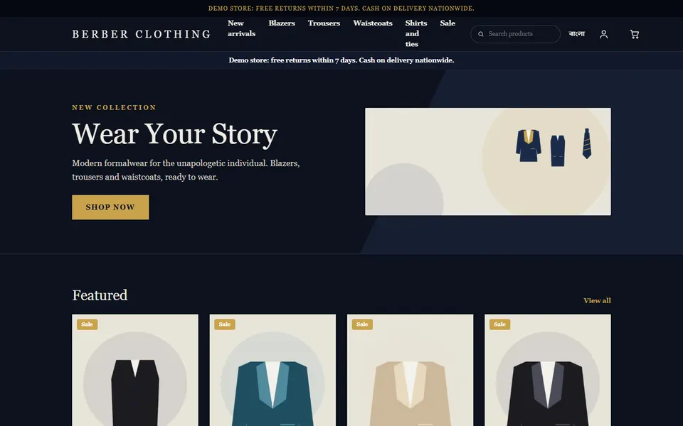<br /><b>Berber</b><br /><sub>Dark, editorial tailoring</sub></td>
</tr>
</table>

---

## 🧱 Architecture

Four Next.js apps share one codebase and one Postgres database. Every store is a **tenant**; Postgres itself enforces that one store can never read another's rows.

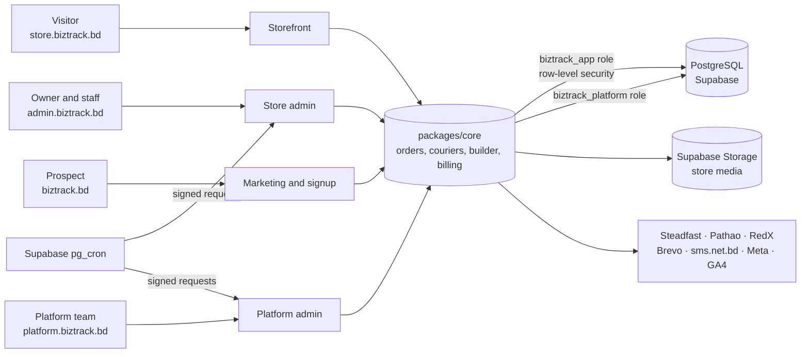

| Layer | What it does |
|---|---|
| **Tenancy** | Every table carries `tenantId`. Row-level security policies use `current_tenant()`, set per transaction by `withTenant()`. The app connects as `biztrack_app` (no `BYPASSRLS`); only the platform role sees across stores. An audit script (`pnpm audit:rls`) proves it. |
| **Routing** | `proxy.ts` maps a hostname to a store: `*.biztrack.bd` subdomains and merchants' own domains. Reserved names cannot be claimed. |
| **Order safety** | One order service: prices computed server-side, atomic stock reservation, idempotency keys so a double tap makes one order, and a state machine for every status change. |
| **Secrets** | Each store's courier and payment keys are encrypted with AES-256-GCM, bound to the store and provider, and never sent back to a browser. |
| **Builder** | Pages are validated JSON (`sections`), drawn by the same React components on the live store and in the editor's preview, so they cannot drift. Drafts, versions and conflict detection are server-side. |
| **Background work** | Supabase `pg_cron` calls protected cron routes: abandoned carts, courier status sync, domain checks, loyalty expiry, billing sweeps, demo-store refresh. |
| **Backups** | A nightly GitHub Actions job dumps the database, encrypts it, and stores it in Supabase Storage; a restore drill verifies it. |

### Stack

| | |
|---|---|
| App framework | Next.js 16 (App Router, server actions, Turbopack), React 19 |
| Language | TypeScript, strict |
| Database | PostgreSQL 16/17 on Supabase, Prisma 7 with the `pg` driver adapter, hand-written RLS migrations |
| Auth | Supabase Auth: email codes, passwords, and TOTP two-step for the platform team |
| Monorepo | pnpm workspaces + Turborepo |
| Messaging | Brevo (email), sms.net.bd and Greenweb (SMS) |
| Hosting | Vercel (four projects, Git integration), Supabase, DNS on Vercel |
| Tests | Vitest, Playwright, axe-core accessibility checks |

---

## 🛡️ Built to be trusted

- **Isolation proven, not assumed.** Cross-tenant reads and writes are tested against a live database under RLS.
- **Accessibility is a test.** Every admin screen is checked with axe at phone and desktop width, in light and dark, for contrast, tap-target size and sideways scroll.
- **Server-recalculated money.** The cart in the browser holds ids and quantities only.
- **Write-only keys.** Saved secrets are shown as "Saved. Type to replace." and never returned.
- **Abuse brakes.** Rate limits on sign-in, order placement and codes; honeypot signup field; brand-risk scan on new store names.
- **Demo stores cannot be abused.** Writes that matter (orders, SMS codes, reviews, carts) are refused at the lowest level, and the stores are rebuilt nightly.

---

## 🚀 Run it locally

Needs Node 22, pnpm 10 and a PostgreSQL 16 database.

```bash
pnpm install
cp .env.example .env.local        # point the database URLs at your Postgres
pnpm db:migrate                   # schema and row-level security (run as the owner role)
psql "$DIRECT_URL" -v app_pw="'choose-one'" -v platform_pw="'choose-another'" -f scripts/db-roles.sql
pnpm db:seed                      # a demo store: rongdhonu
node tools/dev-local.mjs          # all four apps against the local database
```

| App | Address | What it is |
|---|---|---|
| Storefront | http://rongdhonu.localhost:3000 | The customer-facing store |
| Store admin | http://localhost:3001 | Orders, products, customers, design (`DEV_AUTH=1` signs in a seeded owner) |
| Marketing | http://localhost:3002 | Home, pricing, templates, signup |
| Platform admin | http://localhost:3003 | Plans, payments, stores, audit |

Build the six template demo stores locally, then take their previews:

```bash
pnpm --filter @biztrackbd/core exec tsx scripts/demo-stores.ts all
node tools/demo-previews.mjs
```

### Quality gates

```bash
pnpm typecheck && pnpm lint        # strict types, lint
pnpm test                          # core, database and media suites (650+ tests)
pnpm build && pnpm check:size      # production builds and the size budget
pnpm verify                        # all of the above plus a dependency audit
pnpm e2e                           # Playwright at 390 px and 1440 px
pnpm audit:rls                     # proves tenant isolation on a live database
```

Four GitHub Actions workflows run the same gates: **CI** on every push and pull request, **E2E** on demand, **Deploy** (database migrations, gated by a repository variable), and a nightly encrypted **Backup**.

---

## ☁️ Deploy it

The reference deployment is four Vercel projects (marketing, admin, platform, storefront) in front of one Supabase project, with the domain's DNS on Vercel so store subdomains get a wildcard certificate.

1. Create the Supabase project, apply the migrations, and create the `biztrack_app` and `biztrack_platform` logins.
2. Create the four Vercel projects from this repository, each with its app folder as the Root Directory.
3. Generate and load the environment: `node tools/make-vercel-env.mjs` then `node tools/vercel-load-env.mjs --yes`.
4. Install the scheduled jobs: `node tools/supabase-schedule.mjs --admin <url> --platform <url> --yes`.
5. Build the demo stores: `pnpm --filter @biztrackbd/core exec tsx scripts/demo-stores.ts all --target supabase`.

The full, checked walk-through (DNS records, email templates, free-plan limits, what to rotate) is in [`docs/35-production-setup-biztrack-bd.md`](docs/35-production-setup-biztrack-bd.md).

---

## 🗂️ Repository map

```text
apps/
  storefront/   customer store, checkout, tracking, preview endpoint for the builder
  admin/        store admin: orders, catalog, couriers, finance, growth, page builder
  platform/     super admin: tenants, plans, payments, audit
  marketing/    home, pricing, templates, signup wizard
packages/
  core/         all business logic: orders, couriers, billing, builder, loyalty, demo stores
  db/           Prisma schema, migrations, RLS, tenant-scoped client, test fixtures
  media/        image pipeline (crop, WebP, local or Supabase storage)
  ui/           shared page blocks: header, section, KPI row, drawer, save bar, toasts
tools/          deploy, scheduling, secrets, demo previews, UX capture and audits
docs/           40 specs, plans and runbooks
design/canvas/  the original design canvas (88 artboards) the UI is measured against
.github/        CI, E2E, deploy and backup workflows
```

---

## 📚 Documentation

The decisions and the reasoning live in `docs/`. A good order to read them:

<details>
<summary><b>Start here</b></summary>

| Doc | What it covers |
|---|---|
| [01 Architecture and roadmap](docs/01-architecture-and-roadmap.md) | Product decisions, multi-tenant architecture, phased roadmap |
| [05 Decisions log](docs/05-decisions-log.md) | Confirmed decisions and the open questions |
| [08 Database schema and RLS](docs/08-database-schema-and-rls-spec.md) | The schema, composite indexes, and every RLS policy |
| [27 Order state machine](docs/27-unified-order-state-machine-and-transaction-safety.md) | Order creation, stock reservation, idempotency |
| [32 Security review](docs/32-security-review.md) | Threats considered and how each is handled |

</details>

<details>
<summary><b>Product and design</b></summary>

[02 UI/UX plan](docs/02-uiux-plan.md) · [06 Theme builder spec](docs/06-theme-builder-and-manifest-spec.md) · [07 Feature specification](docs/07-complete-features-specification.md) · [09 Design canvas guide](docs/09-design-canvas-implementation-guide.md) · [29 Screen index](docs/29-design-canvas-screen-index.md) · [36 UX rebuild decisions](docs/36-ux-rebuild-decisions.md) · [37 UX rebuild plan](docs/37-ux-rebuild-implementation-plan.md) · [38 Template demo stores](docs/38-template-demo-stores-plan.md) · [39 Editable store pages](docs/39-builder-more-pages-plan.md) · [40 Store admin screens](docs/40-ux-phase4-store-admin-plan.md)

</details>

<details>
<summary><b>Bangladesh-specific operations</b></summary>

[10 Courier and payment protocols](docs/10-courier-and-gateway-integration-protocol.md) · [12 Fraud and abuse policy](docs/12-operations-fraud-and-abuse-policy.md) · [26 Loyalty and referrals](docs/26-customer-loyalty-vip-tiers-and-referrals-spec.md) · [28 COD reconciliation and accounting](docs/28-commercial-excellence-cod-reconciliation-and-accounting-spec.md)

</details>

<details>
<summary><b>Platform, deployment and operations</b></summary>

[04 Integrations and secrets](docs/04-integrations-and-secrets.md) · [13 Edge routing and SSL](docs/13-edge-routing-and-domain-ssl-architecture.md) · [17 Environment variables](docs/17-environment-variables-and-configuration.md) · [19 Disaster recovery and backups](docs/19-disaster-recovery-and-backups.md) · [34 Release hardening and free-tier plan](docs/34-release-hardening-and-free-tier-plan.md) · [35 Production setup](docs/35-production-setup-biztrack-bd.md)

</details>

<details>
<summary><b>Quality</b></summary>

[15 Testing and QA strategy](docs/15-testing-and-qa-strategy.md) · [33 Codebase against docs](docs/33-codebase-vs-docs-audit.md) · [`checkup/`](checkup/) (audit reports and the UX gap report)

</details>

---

## 🧭 Status

BizTrackBD is in **pilot**: the four apps are deployed, the core selling and operations flows are built and tested, and the interface is being rebuilt screen by screen to match the design canvas. Done so far: the admin shell, the page builder, the marketing site, and the first store-admin screens. Next: products, the dashboard, and the platform admin screens.

Some specs in `docs/` describe later phases (a public REST API, an app marketplace, a WhatsApp chatbot, an AI copywriter). They are plans, not shipped features.

## 📄 Licence

No open-source licence has been chosen yet. The code is public so it can be read and reviewed; please ask before reusing it.

<div align="center"><sub>Built by <a href="https://www.digitaldude.co.uk">The Digital Dude</a> · <a href="https://www.digitaldude.co.uk/work/biztrackbd-ecommerce-platform">Read the case study</a></sub></div>

<div align="center"><sub>Made in Bangladesh, with Claude Code as a pair programmer.</sub></div>
