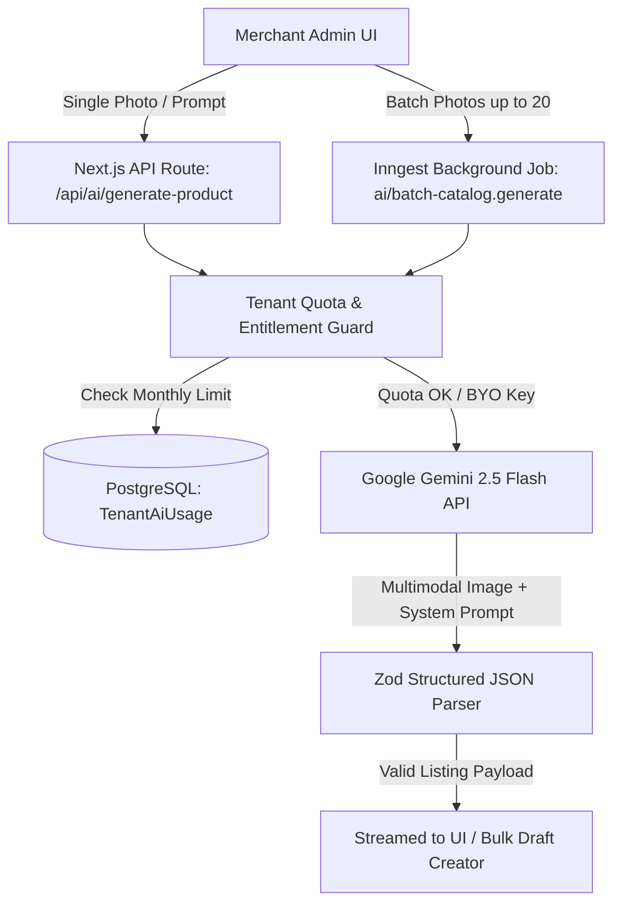

> **Status: deferred, not built (post-v1, docs/05).** Nothing in this document exists in the code; `/api/ai/batch-catalog` is a design only.

# AI Copywriter & Multimodal Catalog Generator Specification

## 1. Executive Summary & Value Proposition

In the Bangladeshi ecommerce ecosystem, merchant product catalog creation is a major friction point. Small merchants (F-commerce sellers transitioning to web) take high-quality phone photos of their garments, gadgets, and cosmetics, but struggle to write compelling, grammatically sound, SEO-optimized Bengali descriptions and Facebook ad copy.

**BizTrackBD AI Copywriter** leverages Google Gemini 2.5 Flash with multimodal visual recognition and tailored Bangladeshi cultural tone presets to turn raw product photos or minimal keywords into complete, high-converting product listings in under 3 seconds.

---

## 2. System Architecture & Quota Metering



### 2.1 Subscription Quotas & Token Tiers

| Plan Tier | Monthly Free AI Generations | Features Included | BYO API Key Option |
|---|---|---|---|
| **Starter** (৳699/mo) | 50 generations/month | Single product Magic Wand (Text & Photo), SEO Meta | No |
| **Pro** (৳1,499/mo) | 250 generations/month | Magic Wand + Multimodal Photo analysis + Tone Presets + Ad Copy | Yes |
| **Business** (৳3,499/mo) | 1,000 generations/month | Full suite + Bulk 20-image catalog batch wizard + Priority Gemini speed | Yes (Unlimited) |

### 2.2 Database Schema (`TenantAiUsage`)

```prisma
model TenantAiUsage {
  id              String   @id @default(cuid())
  tenantId        String
  periodMonth     String   // Format: "YYYY-MM" (e.g. "2026-10")
  generationCount Int      @default(0)
  tokenCount      Int      @default(0)
  customApiKey    String?  // AES-256 encrypted merchant BYO Gemini API Key
  updatedAt       DateTime @updatedAt

  tenant          Tenant   @relation(fields: [tenantId], references: [id], onDelete: Cascade)

  @@unique([tenantId, periodMonth])
  @@index([tenantId])
}
```

---

## 3. Cultural Tone Presets for Bangladesh

Merchants can select one of 4 predefined cultural tone presets:

```typescript
export type AiTonePreset = 
  | 'DHAKA_YOUTH_TRENDY'    // Modern Banglish, street-smart, high energy for young demographic
  | 'TRADITIONAL_ELEGANT'   // Poetic, respectful, refined Bangla for Sarees, Panjabis, Eid collections
  | 'LUXURY_PREMIUM'       // Sophisticated, aspirational, focusing on heritage, purity & craftsmanship
  | 'TECH_MINIMALIST';      // Direct, spec-heavy, highlighting warranty, authenticity & performance
```

### 3.1 System Prompts & Cultural Dialect Rules

```typescript
// packages/ai/src/prompts.ts
export const SYSTEM_PROMPT_COPYWRITER = `
You are the lead ecommerce copywriter for top Bangladeshi lifestyle & tech retail brands (similar to Aarong, Yellow, Apex, Star Tech).
Your task is to analyze product images and/or merchant notes, and output a complete, conversion-optimized ecommerce listing in natural Bengali (বাংলা) and English.

CULTURAL & LINGUISTIC RULES:
1. Bengali must be natural, engaging, and grammatically accurate (চলিত ভাষা). Avoid awkward literal machine translations.
2. For Trendy/Fashion items, use modern shopping vocabulary familiar to Dhaka/Chittagong youth (e.g., "প্রিমিয়াম কোয়ালিটি", "স্টাইলিশ লুক", "পারফেক্ট ফিটিং", "ক্যাশ অন ডেলিভারি").
3. Always generate clean semantic HTML for the description body with bullet points (<ul><li>) for key specifications, fabric details, and care instructions.
4. Output strictly structured JSON conforming to the schema.
`;
```

---

## 4. Output Data Contract & Zod Schema

```typescript
// packages/ai/src/schemas.ts
import { z } from 'zod';

export const GeneratedProductSchema = z.object({
  titleBn: z.string().describe("Compelling Bengali title (e.g., প্রিমিয়াম সুতি কটন ডিজিটাল প্রিন্ট থ্রি-পিস)"),
  titleEn: z.string().describe("English title for URLs and search (e.g., Premium Digital Print Cotton Three-Piece)"),
  shortExcerptBn: z.string().max(200).describe("Punchy 1-2 sentence Bengali summary for cards and quick views"),
  descriptionHtml: z.string().describe("Rich semantic HTML description with specifications, fabric details, and care guide"),
  categorySuggestion: z.string().describe("Suggested category name in English (e.g., Women's Fashion > Three-Piece)"),
  tags: z.array(z.string()).max(8).describe("SEO & filter tags in Bengali and English"),
  seo: z.object({
    metaTitle: z.string().max(60).describe("SEO Meta Title with store keyword under 60 chars"),
    metaDescription: z.string().max(155).describe("SEO Meta Description with CTA under 155 chars")
  }),
  adCopy: z.object({
    facebookCaption: z.string().describe("Engaging Facebook/Instagram caption with emojis, bullet points, price placeholder and Order Now CTA")
  }),
  detectedAttributes: z.object({
    primaryColor: z.string().optional(),
    fabricOrMaterial: z.string().optional(),
    pattern: z.string().optional()
  })
});

export type GeneratedProduct = z.infer<typeof GeneratedProductSchema>;
```

---

## 5. Implementation Engine (`packages/ai/src/gemini.ts`)

```typescript
import { GoogleGenAI, Type } from '@google/genai';
import { GeneratedProductSchema, GeneratedProduct } from './schemas';
import { SYSTEM_PROMPT_COPYWRITER } from './prompts';

interface GenerateOptions {
  apiKey: string;
  imageBuffers?: { mimeType: string; data: Buffer }[];
  titleHint?: string;
  keywords?: string[];
  price?: number;
  tone: 'DHAKA_YOUTH_TRENDY' | 'TRADITIONAL_ELEGANT' | 'LUXURY_PREMIUM' | 'TECH_MINIMALIST';
}

export async function generateProductListing(options: GenerateOptions): Promise<GeneratedProduct> {
  const ai = new GoogleGenAI({ apiKey: options.apiKey });
  
  const parts: any[] = [];
  
  // Attach multimodal images if provided
  if (options.imageBuffers && options.imageBuffers.length > 0) {
    for (const img of options.imageBuffers) {
      parts.push({
        inlineData: {
          mimeType: img.mimeType,
          data: img.data.toString('base64'),
        }
      });
    }
  }

  const promptText = `
Tone Preset: ${options.tone}
Product Hint: ${options.titleHint || 'Analyze uploaded photo'}
Target Keywords: ${options.keywords?.join(', ') || 'N/A'}
Approx Price (BDT): ${options.price ? `৳${options.price}` : 'Not specified'}

Analyze the product and generate the complete bilingual listing JSON.
`;

  parts.push({ text: promptText });

  const response = await ai.models.generateContent({
    model: 'gemini-2.5-flash',
    contents: parts,
    config: {
      systemInstruction: SYSTEM_PROMPT_COPYWRITER,
      responseMimeType: 'application/json',
      responseSchema: {
        type: Type.OBJECT,
        properties: {
          titleBn: { type: Type.STRING },
          titleEn: { type: Type.STRING },
          shortExcerptBn: { type: Type.STRING },
          descriptionHtml: { type: Type.STRING },
          categorySuggestion: { type: Type.STRING },
          tags: { type: Type.ARRAY, items: { type: Type.STRING } },
          seo: {
            type: Type.OBJECT,
            properties: {
              metaTitle: { type: Type.STRING },
              metaDescription: { type: Type.STRING },
            },
            required: ['metaTitle', 'metaDescription']
          },
          adCopy: {
            type: Type.OBJECT,
            properties: {
              facebookCaption: { type: Type.STRING },
            },
            required: ['facebookCaption']
          },
          detectedAttributes: {
            type: Type.OBJECT,
            properties: {
              primaryColor: { type: Type.STRING },
              fabricOrMaterial: { type: Type.STRING },
              pattern: { type: Type.STRING },
            }
          }
        },
        required: ['titleBn', 'titleEn', 'shortExcerptBn', 'descriptionHtml', 'categorySuggestion', 'tags', 'seo', 'adCopy']
      }
    }
  });

  const parsed = JSON.parse(response.text || '{}');
  return GeneratedProductSchema.parse(parsed);
}
```

---

## 6. Admin UI Interaction Flows

### 6.1 In-Editor "Magic Wand"

Inside the Admin Product Editor (`/admin/products/[id]/edit` or `/admin/products/new`):
1. **Header AI Bar**: A floating button `[✨ AI Magic Auto-Fill]` opens a modal allowing the merchant to upload 1-3 photos, pick a Tone (`Trendy`, `Traditional`, `Luxury`, `Minimal`), and click `[Generate Full Listing]`.
2. **Field-Level Wand**:
   - Next to Title: `[✨ Rewrite in Bangla / English]`
   - Inside TipTap Description Editor: `[✨ Expand Features into Rich HTML]`
   - Next to SEO Meta: `[✨ Generate High-Rank Keywords & Tags]`
   - Next to Social Share: `[✨ Copy Facebook Ad Caption]`

### 6.2 Bulk AI Catalog Wizard (`/admin/products/ai-bulk`)

1. **Dropzone**: Merchant drags up to 20 product images at once.
2. **Background Dispatch**: Client sends images to `/api/ai/batch-catalog` which triggers an Inngest durable job `ai/batch-catalog.generate`.
3. **Interactive Review Grid**: As Gemini processes each image, items pop up in an editable review table:
   - Thumbnail Preview
   - Auto-generated Title (editable inline)
   - Auto-detected Category & Price input
   - Status badge (`Ready`, `Generating...`, `Error`)
4. **1-Click Batch Publish**: Merchant clicks `[Publish All as Active]` or `[Save as Drafts]`.

---

## 7. Rate Limiting, Safety & Error Handling

1. **Sliding Window Rate Limit**: Max 10 requests / minute per tenant to prevent concurrent spam attacks.
2. **Content Safety Checks**: Gemini built-in filters configured for zero tolerance on hate speech, harassment, and explicit adult material.
3. **Graceful Fallback**: If Gemini fails or times out (> 8 seconds), return a polite toast `AI generation timed out. Please try again or fill fields manually.` without interrupting the merchant's workflow.
4. **Quota Exhaustion UX**: When tenant reaches 100% of their monthly tier quota, display a sleek banner:
   `You've used all 250 AI generations for October. Upgrade to Business (1,000/mo) or insert your own Google Gemini API key in Settings.`
