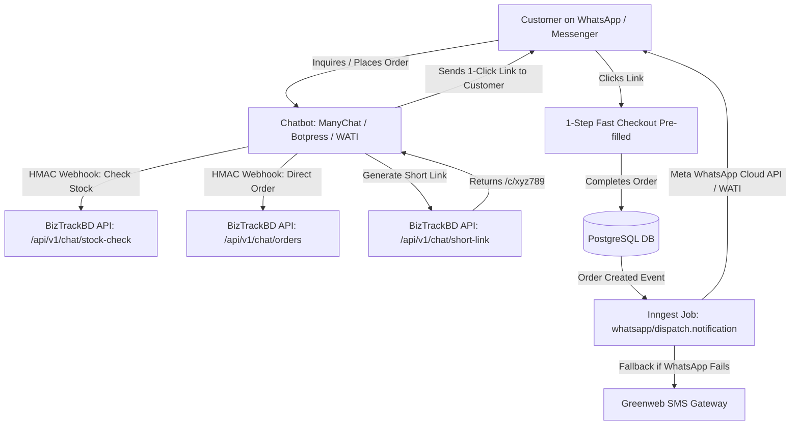

# WhatsApp & Messenger Chatbot Integration & Automated Webhook Specification

## 1. Executive Summary & Chat-Commerce Context

In Bangladesh, over 40% of conversational commerce happens directly inside Facebook Messenger and WhatsApp Business chats. Customers frequently inquire about products on Facebook Pages or WhatsApp numbers managed by automated chatbots (ManyChat, Botpress, WATI) or human sales agents.

This specification details:
1. **Headless Chatbot Webhook API** for bots to check live product stock, calculate delivery fees, and create verified orders directly.
2. **Dynamic 1-Click Pre-filled Checkout Short Links** (`/c/[shortCode]`) that bots can generate and send to customers in chat.
3. **Automated Outbound WhatsApp Notifications** with live Steadfast/Pathao tracking links and automatic Greenweb SMS fallback.

---

## 2. Architecture & Data Flow



---

## 3. Headless Chatbot Webhook Endpoints

All inbound chatbot API requests must be signed with the tenant's API Secret using HMAC-SHA256 in the `X-BizTrack-Signature` header.

### 3.1 Live Stock & Pricing Check (`POST /api/v1/chat/stock-check`)

Allows the bot to verify if a requested variant is in stock before taking an order:

**Request Payload:**
```json
{
  "productSlugOrSku": "cotton-panjabi-001",
  "variantOptions": {
    "Size": "L",
    "Color": "Black"
  },
  "quantity": 1,
  "deliveryZone": "INSIDE_DHAKA"
}
```

**Response Payload:**
```json
{
  "success": true,
  "data": {
    "productId": "cuid_prod_123",
    "variantId": "cuid_var_456",
    "productTitle": "প্রিমিয়াম সুতি কটন পাঞ্জাবি",
    "inStock": true,
    "availableQuantity": 18,
    "unitPrice": 1450.00,
    "deliveryCharge": 70.00,
    "estimatedTotal": 1520.00,
    "estimatedDeliveryDays": "1-2 days"
  }
}
```

---

### 3.2 Direct Chat Order Creation (`POST /api/v1/chat/orders`)

Allows the bot (or human chat agent) to directly inject an order into the store:

**Request Payload:**
```json
{
  "channel": "WHATSAPP_BOT",
  "externalChatId": "wa_8801711223344",
  "customer": {
    "name": "Rahat Rahman",
    "phone": "01711223344",
    "address": "House 12, Road 5, Dhanmondi",
    "district": "Dhaka",
    "division": "Dhaka",
    "deliveryZone": "INSIDE_DHAKA"
  },
  "items": [
    {
      "variantId": "cuid_var_456",
      "quantity": 1
    }
  ],
  "paymentMethod": "COD",
  "couponCode": "CHAT50",
  "merchantNotes": "Customer requested delivery after 5 PM"
}
```

**Processing Logic:**
1. **Phone Validation**: Validates `01XXXXXXXXX` (11 digits).
2. **Fraud Trust Score Check**: Runs phone through Delivery Trust Engine (Doc 12). If score < 40, tags order with `RISK_HIGH`.
3. **Inventory Allocation**: Atomically decrements `stockQuantity`.
4. **Order Attribution**: Sets `orderSource = "WHATSAPP_BOT"`, `channel = "CONVERSATIONAL"`.
5. **CAPI Event**: Fires Facebook/TikTok Server-Side CAPI `Purchase` event.

---

## 4. Dynamic 1-Click Pre-filled Checkout Short Links

When customers prefer to enter their own address or pay via bKash/Card, the bot generates a pre-filled short link:

### 4.1 Short Link Generation (`POST /api/v1/chat/short-link`)

**Request Payload:**
```json
{
  "items": [
    { "variantId": "cuid_var_456", "quantity": 1 }
  ],
  "couponCode": "EID2026",
  "customer": {
    "name": "Rahat",
    "phone": "01711223344"
  },
  "source": "MESSENGER_BOT",
  "ttlHours": 72
}
```

**Response:**
```json
{
  "success": true,
  "shortUrl": "https://rongdhonu.biztrack.bd/c/xK9p2L",
  "expiresAt": "2026-10-13T03:30:00.000Z"
}
```

### 4.2 Database Schema (`CartShortLink`)

```prisma
model CartShortLink {
  id          String   @id @default(cuid())
  tenantId    String
  shortCode   String   @unique
  payloadJson Json     // Contains items, customer info, pre-applied coupon, and attribution
  source      String   // "WHATSAPP_BOT" | "MESSENGER_BOT" | "TELEMARKETING"
  clicksCount Int      @default(0)
  isConverted Boolean  @default(false)
  orderId     String?
  expiresAt   DateTime
  createdAt   DateTime @default(now())

  tenant      Tenant   @relation(fields: [tenantId], references: [id], onDelete: Cascade)

  @@index([tenantId, shortCode])
  @@index([expiresAt])
}
```

---

## 5. Automated Outbound WhatsApp Notifications

When orders transition through lifecycle stages, Inngest triggers WhatsApp Cloud API template dispatches:

### 5.1 Notification Event Catalog

| Trigger Event | Template Name | Key Variables Included | Fallback to SMS? |
|---|---|---|---|
| `order.confirmed` | `order_confirm_v1` | Customer Name, Order #, Total BDT, Payment Method, Store Name | Yes (if unsent after 2m) |
| `courier.dispatched` | `order_dispatch_v1` | Courier Name, Consignment ID, Live Tracking Link, Expected Delivery Date | Yes |
| `courier.out_for_delivery` | `out_for_delivery_v1` | Rider Phone (if available), COD Amount to keep ready | Yes |
| `order.abandoned_recovery` | `abandoned_nudge_v1` | Customer Name, Abandoned Product, 1-Click Recovery Link with Discount | Yes |

### 5.2 Template Example: `courier_dispatched` (Bengali)

```text
প্রিয় {{1}}, 
আপনার অর্ডারের পণ্যগুলো (অর্ডার নং #{{2}}) {{3}} কুরিয়ারে হস্তান্তর করা হয়েছে। 

📦 ট্র্যাকিং আইডি: {{4}}
🔗 পার্সেল ট্র্যাক করুন: {{5}}
💰 ক্যাশ অন ডেলিভারি বাবদ প্রদেয়: ৳{{6}}

আমাদের সাথে থাকার জন্য ধন্যবাদ!
{{7}} ({{8}})
```

---

## 6. Inngest Notification Workflow Implementation

```typescript
// packages/jobs/src/functions/whatsapp-dispatch.ts
import { inngest } from '../client';
import { sendWhatsAppTemplate } from '@biztrackbd/integrations/whatsapp';
import { sendGreenwebSms } from '@biztrackbd/integrations/sms';

export const dispatchOrderNotification = inngest.createFunction(
  { id: 'dispatch-order-notification', retries: 2 },
  { event: 'order/notification.send' },
  async ({ event, step }) => {
    const { tenantId, orderId, templateType, customerPhone, variables } = event.data;

    // Step 1: Attempt WhatsApp Dispatch
    const waResult = await step.run('send-whatsapp', async () => {
      return await sendWhatsAppTemplate({
        tenantId,
        phone: customerPhone,
        template: templateType,
        variables,
      });
    });

    // Step 2: Fallback to Greenweb SMS if WhatsApp fails or customer is not on WhatsApp
    if (!waResult.success) {
      await step.run('fallback-sms', async () => {
        const smsMessage = buildSmsFallbackText(templateType, variables);
        return await sendGreenwebSms({
          tenantId,
          recipient: customerPhone,
          message: smsMessage,
        });
      });
    }

    return { status: waResult.success ? 'WHATSAPP_SENT' : 'SMS_FALLBACK_SENT' };
  }
);
```

---

## 7. Security, Abuse Prevention & Rate Limits

1. **HMAC Signature Check**: Every inbound webhook from ManyChat/Botpress is verified with secret token hash.
2. **Short Link Rate Limiting**: Max 100 short links generated per hour per tenant to avoid link spamming.
3. **WhatsApp Opt-Out Compliance**: Customers replying "STOP" or "থামুন" are automatically added to the tenant's `SmsOptOut` list, blocking further automated promotional notifications.
