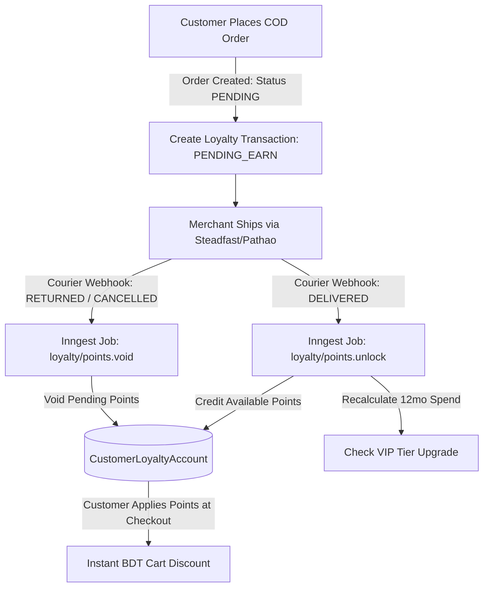

# Customer Loyalty, VIP Tiers & Referral Rewards Specification

## 1. Executive Summary & Growth Mechanics

In Bangladeshi ecommerce, customer acquisition costs (Meta ads) are constantly rising. Retaining high-value repeat buyers and empowering satisfied customers to refer their friends via WhatsApp and Facebook are the highest-ROI growth drivers.

This specification details:
1. **Configurable Loyalty Points Engine** with fraud-safe delivery verification (points unlock only after courier marks COD orders as `DELIVERED`).
2. **4-Tier Automated VIP System** (Bronze, Silver, Gold, Platinum) with dynamic point multipliers, permanent discounts, and free shipping perks.
3. **Double-Sided Verified Referral Engine** offering instant discounts for friends and verified reward points for referrers.

---

## 2. Loyalty Points Architecture & Lifecycle



---

## 3. Database Schema (`packages/db/prisma/schema.prisma`)

```prisma
enum LoyaltyTxType {
  EARN_PURCHASE
  REDEEM_PURCHASE
  REFERRAL_BONUS
  TIER_BONUS
  MANUAL_ADJUSTMENT
  EXPIRED
}

enum LoyaltyTxStatus {
  PENDING   // Awaiting courier delivery confirmation
  CONFIRMED // Unlocked and spendable
  VOIDED    // Cancelled / parcel returned
}

enum VipTierLevel {
  BRONZE
  SILVER
  GOLD
  PLATINUM
}

model CustomerLoyaltyAccount {
  id              String         @id @default(cuid())
  tenantId        String
  customerId      String         @unique
  availablePoints Int            @default(0)
  pendingPoints   Int            @default(0)
  lifetimePoints  Int            @default(0)
  currentTier     VipTierLevel   @default(BRONZE)
  rollingSpend12m Decimal        @default(0.00) @db.Decimal(12, 2)
  referralCode    String         @unique
  createdAt       DateTime       @default(now())
  updatedAt       DateTime       @updatedAt

  tenant          Tenant         @relation(fields: [tenantId], references: [id], onDelete: Cascade)
  customer        Customer       @relation(fields: [customerId], references: [id], onDelete: Cascade)
  transactions    LoyaltyTransaction[]
  referralsMade   CustomerReferral[]   @relation("Referrer")

  @@index([tenantId, customerId])
  @@index([referralCode])
}

model LoyaltyTransaction {
  id          String          @id @default(cuid())
  tenantId    String
  accountId   String
  orderId     String?
  points      Int             // Positive for earn, negative for redeem
  amountBdt   Decimal?        @db.Decimal(12, 2)
  type        LoyaltyTxType
  status      LoyaltyTxStatus @default(PENDING)
  description String
  expiresAt   DateTime?
  createdAt   DateTime        @default(now())

  tenant      Tenant          @relation(fields: [tenantId], references: [id], onDelete: Cascade)
  account     CustomerLoyaltyAccount @relation(fields: [accountId], references: [id], onDelete: Cascade)

  @@index([tenantId, accountId])
  @@index([orderId])
  @@index([expiresAt])
}

model CustomerReferral {
  id              String   @id @default(cuid())
  tenantId        String
  referrerId      String
  refereePhone    String
  firstOrderId    String?  @unique
  bonusPoints     Int      @default(100)
  isDelivered     Boolean  @default(false)
  rewardClaimedAt DateTime?
  createdAt       DateTime @default(now())

  tenant          Tenant   @relation(fields: [tenantId], references: [id], onDelete: Cascade)
  referrerAccount CustomerLoyaltyAccount @relation("Referrer", fields: [referrerId], references: [id], onDelete: Cascade)

  @@index([tenantId, referrerId])
  @@index([refereePhone])
}
```

---

## 4. VIP Tier Progression & Benefits

| Tier Level | 12-Month Delivered Spend Required | Points Multiplier | Automatic Perks |
|---|---|---|---|
| **Bronze** | ৳0 – ৳4,999 | 1.0x (Standard) | Access to member-only coupon drops |
| **Silver** | ৳5,000 – ৳14,999 | 1.25x Points | Silver Account Badge + ৳100 Birthday Voucher |
| **Gold** | ৳15,000 – ৳34,999 | 1.5x Points | Gold Badge + 5% Permanent Storewide Discount + Priority Packing |
| **Platinum** | ৳35,000+ | 2.0x Points | Platinum Badge + 10% Permanent Discount + **Free Delivery Nationwide** |

### 4.1 Automatic Tier Evaluation Logic

Whenever an order transitions to `DELIVERED`:
1. System sums all `Order.totalAmount` delivered for that customer in the past 365 days.
2. If `rollingSpend12m` crosses a tier threshold:
   - Updates `CustomerLoyaltyAccount.currentTier`.
   - Sends an automated celebration SMS & WhatsApp message:
     *"অভিনন্দন {{CustomerName}}! আপনি এখন {{StoreName}}-এর Gold VIP মেম্বার। পরবর্তী সব অর্ডারে পাবেন 5% এক্সট্রা ডিসকাউন্ট ও 1.5x রিওয়ার্ড পয়েন্ট!"*

---

## 5. Double-Sided Referral Mechanics & Fraud Shield

### 5.1 Referral Flow

1. **Unique Code Generation**: Customer "Rahat Rahman" receives referral code `REF-RAHAT-92A` and link `https://mystore.com/ref/REF-RAHAT-92A`.
2. **Friend Experience**:
   - Friend clicks link -> 1-click discount banner appears: *"রাহাত আপনাকে ৳৫০ ছাড় উপহার দিয়েছেন! প্রথম অর্ডারে এখনই ব্যবহার করুন।"*
   - Coupon `REF-RAHAT-92A` auto-applies at checkout (৳50 off on minimum ৳500 cart).
3. **Reward Unlock with Fraud Shield**:
   - When the friend places the order, a `CustomerReferral` row is recorded in `isDelivered = false` state.
   - **Fraud Guard Checks**:
     - Referee phone number must never have placed an order with this store before.
     - Referee shipping phone cannot match Referrer phone.
     - Client IP and browser fingerprint must not match Referrer checkout history.
   - When the courier webhook fires `status: "DELIVERED"`, Inngest credits **100 Points** (`status: CONFIRMED`) to Rahat's loyalty account and sends an SMS notification.

---

## 6. Storefront & 1-Step Checkout UI Integration

### 6.1 Storefront Header & My Account

- **Header Points Pill**: Displays `✨ 340 Pts (৳34)` next to the account icon.
- **Account Dashboard**: Shows:
  - Current VIP Tier Progress Bar (e.g. *"৳1,200 more to unlock Gold VIP"*).
  - Points History Ledger (Earned, Spent, Expiring Soon).
  - 1-Click WhatsApp Share Referral Link button.

### 6.2 1-Step Checkout Points Toggle

Inside the 1-Step Checkout form (`/checkout`):

```tsx
<div className="rounded-xl border border-indigo-100 bg-indigo-50/50 p-4">
  <div className="flex items-center justify-between">
    <div className="flex items-center gap-2">
      <Sparkles className="h-5 w-5 text-indigo-600" />
      <div>
        <p className="text-sm font-semibold text-navy-900">রিওয়ার্ড পয়েন্ট ব্যবহার করুন</p>
        <p className="text-xs text-ink-3">আপনার একাউন্টে ৩৪০ পয়েন্ট (৳৩৪) আছে</p>
      </div>
    </div>
    <Switch 
      checked={redeemPoints} 
      onCheckedChange={setRedeemPoints} 
    />
  </div>
  {redeemPoints && (
    <div className="mt-3 flex items-center justify-between border-t border-indigo-100 pt-2 text-sm text-indigo-900 font-medium">
      <span>পয়েন্ট ডিসকাউন্ট:</span>
      <span className="text-emerald-600 font-bold">-৳৩৪.০০</span>
    </div>
  )}
</div>
```

---

## 7. Merchant Admin Settings & Analytics

Under Store Admin (`/admin/marketing/loyalty`):
1. **Toggle Program**: Enable/Disable Loyalty Points and Referral Program.
2. **Earning Rate**: Set `Spend ৳[100] = [1] Point`.
3. **Redemption Rate**: Set `[10] Points = ৳[10] Discount` (with optional max cart limit e.g. 30%).
4. **Referral Rewards**: Set Referee discount (`৳50`) and Referrer reward (`100 Points`).
5. **Top VIP Leaderboard**: View top 50 VIP customers by lifetime spend with 1-click WhatsApp message broadcast.

---

## Phase 9 status (what was built from this spec)

Built: the schema (with the additions in docs/08), earning on delivery, spending at checkout, the four VIP levels, double-sided referrals with the phone and address checks, the points header pill, the account page, the checkout toggle, `/marketing/loyalty`, and the SMS to a customer who moves up a level and to a referrer who is rewarded. Inngest is not used: the unlock, void and claw-back happen inside the same transaction as the order's status change, so they cannot be missed or run twice.

Differences from this spec: the browser fingerprint and IP checks on referrals are not built; points do not expire; the birthday voucher and priority packing are not built; the messages are SMS only (no WhatsApp); the level thresholds and perks are fixed in code; spending points and the VIP discount need a signed-in customer (a typed phone number is not proof). See docs/16 Phase 9.


## Phase 10: gaps closed
- **Levels are settings now:** the three thresholds and the Gold and Platinum discounts are the store's own (`/marketing/loyalty`), validated to rise.
- **Returns give spent points back:** a returned order refunds the points it spent as well as taking away the points it earned.
- **Expiry:** with a number of months set, a balance with no activity for that long is cleared (an `EXPIRED` row in the ledger); one SMS is sent about two weeks before. Any order resets the clock. 0 means never.
- **Birthday voucher:** a customer saves month and day once (account page); Silver and above get a one-use fixed-amount coupon `BDAY-xxxxxx`, valid 14 days, once a year. 29 February counts as the 28th in other years.
- **Priority packing:** Gold and Platinum orders are marked and sorted first in "to pack".
- **Delivery that was earned stays free** when the address is edited (`deliveryWaived`).
- **Same-connection referrals are refused:** the order stores a keyed hash of the buyer's address (never the address); a friend whose hash equals the referrer's in the last 90 days is refused. Households and shared offices can be refused wrongly.
- **Plan and switch:** the program also needs the module on (`/settings/apps`) and a plan that includes modules.
- The daily job is `/api/cron/loyalty` (`CRON_SECRET`).
