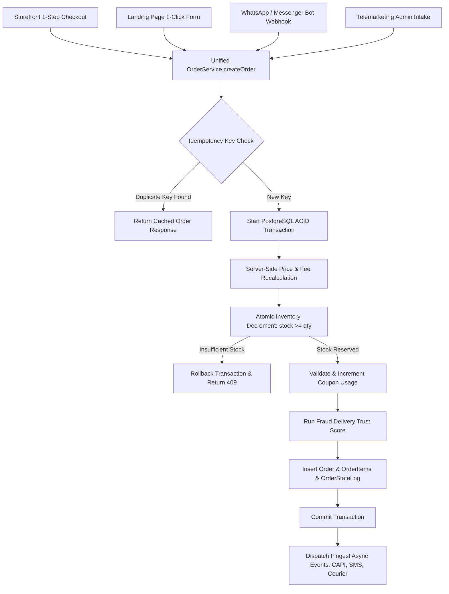
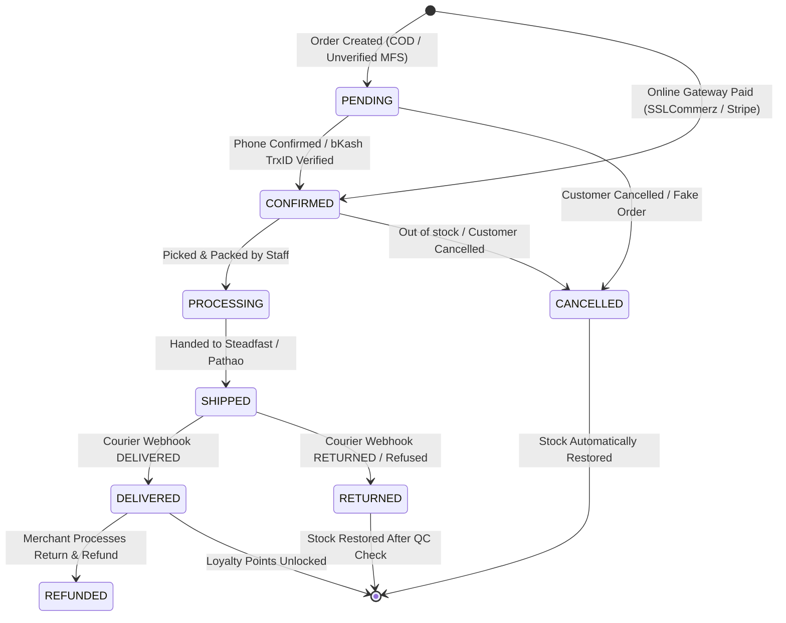

# Unified Order State Machine, Inventory Concurrency & Transaction Safety Protocol

Status: COMPLETE SPECIFICATION (P0 AUDIT REMEDIATION)  
Scope: `packages/core/src/orders`, `packages/db`, `apps/storefront`, `apps/admin`, `apps/api`

---

## 1. Overview & Threat Model

In a multi-channel ecommerce system (Web Storefront, Landing Page, WhatsApp Chatbot, Telemarketing, Merchant Admin), having disparate order creation paths leads to race conditions, overselling, duplicate purchases, and invalid financial calculations.

This specification establishes **One Single Authoritative Order Service (`OrderService.createOrder`)** enforcing strict ACID transactions, atomic inventory reservations, idempotency replay shields, and a deterministic finite state machine.



---

## 2. Server-Side Authoritative Recalculation Protocol

The client is **untrusted**. The server ignores any client-supplied totals, unit prices, or delivery charges:

1. **Product Prices**: Fetched directly from `ProductVariant.price` in the database.
2. **Delivery Charge**: Evaluated authoritatively based on `shippingDistrict` matching `ShippingZone.rate` (e.g. Dhaka Division = ৳70, All other districts = ৳130).
3. **Coupon Verification**:
   - Checks `isActive = true`, `startsAt <= now <= expiresAt`.
   - Checks `usageCount < usageLimit` (if limit set).
   - Validates `subtotalAmount >= minOrderValue`.
   - Calculates discount (`PERCENTAGE` or `FIXED_AMOUNT`).
4. **Loyalty Points Cap**: Maximum 30% of subtotal can be covered by points (10 pts = ৳10 BDT).
5. **Total Formula**:
   $$\text{TotalAmount} = \text{Subtotal} + \text{DeliveryCharge} - \text{CouponDiscount} - \text{LoyaltyDiscount}$$

---

## 3. Atomic Inventory Concurrency & Overselling Prevention

To prevent race conditions during high-traffic flash sales (e.g. 500 customers buying 10 units simultaneously), inventory is decremented using an atomic SQL conditional check:

```typescript
// packages/core/src/orders/inventory.ts
import { PrismaClient } from "@prisma/client";

export async function reserveStockAtomic(
  tx: any,
  items: { variantId: string; quantity: number }[]
) {
  for (const item of items) {
    // Atomic SQL decrement with condition: stockQuantity >= quantity
    const updated = await tx.$executeRaw`
      UPDATE "ProductVariant"
      SET "stockQuantity" = "stockQuantity" - ${item.quantity}
      WHERE id = ${item.variantId} AND "stockQuantity" >= ${item.quantity}
    `;

    if (updated === 0) {
      // Fetch current stock for descriptive error
      const variant = await tx.productVariant.findUnique({
        where: { id: item.variantId },
        include: { product: true }
      });
      
      throw new InsufficientStockError(
        `দুঃখিত! "${variant?.product.title} (${variant?.title})" পর্যাপ্ত স্টকে নেই (অবশিষ্ট: ${variant?.stockQuantity || 0} টি)।`,
        item.variantId
      );
    }
  }
}
```

---

## 4. Idempotency Key Replay Shield

Every order submission passes an `idempotencyKey` (UUID or hash of `phone + cartHash + 5minWindow`):

```typescript
// packages/core/src/orders/idempotency.ts
export async function getOrSetIdempotency(
  tx: any,
  tenantId: string,
  key: string,
  executionFn: () => Promise<{ statusCode: number; data: any }>
) {
  // Check if key already processed
  const existing = await tx.idempotencyRecord.findUnique({
    where: { idempotencyKey: key }
  });

  if (existing) {
    return {
      isReplay: true,
      statusCode: existing.statusCode,
      data: existing.responseJson
    };
  }

  // Execute order creation
  const result = await executionFn();

  // Save idempotency record with 24h TTL
  await tx.idempotencyRecord.create({
    data: {
      tenantId,
      idempotencyKey: key,
      statusCode: result.statusCode,
      responseJson: result.data,
      expiresAt: new Date(Date.now() + 24 * 60 * 60 * 1000)
    }
  });

  return { isReplay: false, ...result };
}
```

---

## 5. Authoritative Order State Machine



### 5.1 Allowed State Transitions Table

| From State | Allowed Target States | Trigger Actor | Automatic Side Effects |
|---|---|---|---|
| **PENDING** | `CONFIRMED`, `CANCELLED` | Customer / Staff / Telemarketer | If `CANCELLED`: Atomic stock restoration + void pending loyalty. |
| **CONFIRMED** | `PROCESSING`, `CANCELLED` | Store Staff | Generates printable Pick List & Packing Slip barcode. |
| **PROCESSING** | `SHIPPED`, `CANCELLED` | Staff / Courier API | Books consignment with Steadfast/Pathao; generates tracking link. |
| **SHIPPED** | `DELIVERED`, `RETURNED` | Courier Webhook | If `DELIVERED`: Unlocks customer loyalty points + records revenue. If `RETURNED`: Flags doorstep refusal in Delivery Trust Engine. |
| **DELIVERED** | `REFUNDED` | Store Admin | Creates `RefundLedger` entry with bKash TrxID; optional stock restoration. |

### 5.2 Stock Restoration on Cancellation

```typescript
export async function restoreOrderStock(tx: any, orderId: string) {
  const orderItems = await tx.orderItem.findMany({
    where: { orderId }
  });

  for (const item of orderItems) {
    if (item.variantId) {
      await tx.$executeRaw`
        UPDATE "ProductVariant"
        SET "stockQuantity" = "stockQuantity" + ${item.quantity}
        WHERE id = ${item.variantId}
      `;
    }
  }
}
```

---

## 6. Complete Implementation: `OrderService.createOrder`

```typescript
// packages/core/src/orders/service.ts
import { basePrisma } from "@biztrackbd/db";
import { reserveStockAtomic } from "./inventory";
import { calculateDeliveryFee } from "./shipping";
import { evaluateFraudTrustScore } from "../fraud";

export interface CreateOrderInput {
  tenantId: string;
  channel: "STOREFRONT" | "LANDING_PAGE" | "WHATSAPP_BOT" | "TELEMARKETING";
  idempotencyKey: string;
  customer: {
    name: string;
    phone: string;
    email?: string;
    address: string;
    district: string;
    division: string;
  };
  items: { variantId: string; quantity: number }[];
  paymentMethod: "COD" | "MANUAL_BKASH" | "MANUAL_NAGAD" | "GATEWAY_SSLCOMMERZ";
  couponCode?: string;
  mfsDetails?: { senderNumber: string; trxId: string };
  redeemLoyaltyPoints?: boolean;
}

export class OrderService {
  static async createOrder(input: CreateOrderInput) {
    return await basePrisma.$transaction(async (tx) => {
      // 1. Enforce PostgreSQL RLS session context
      await tx.$executeRawUnsafe(`SET LOCAL app.current_tenant_id = '${input.tenantId}';`);

      // 2. Check Idempotency Key
      const existingKey = await tx.idempotencyRecord.findUnique({
        where: { idempotencyKey: input.idempotencyKey }
      });
      if (existingKey) {
        return existingKey.responseJson;
      }

      // 3. Atomically reserve inventory
      await reserveStockAtomic(tx, input.items);

      // 4. Server-Side Price & Items Calculation
      let subtotal = 0;
      const orderItemsData = [];

      for (const item of input.items) {
        const variant = await tx.productVariant.findUniqueOrThrow({
          where: { id: item.variantId },
          include: { product: true }
        });

        // Verify product belongs to tenant
        if (variant.product.tenantId !== input.tenantId) {
          throw new Error("Cross-tenant product reference detected.");
        }

        const unitPrice = Number(variant.price);
        const itemTotal = unitPrice * item.quantity;
        subtotal += itemTotal;

        orderItemsData.push({
          tenantId: input.tenantId,
          productId: variant.productId,
          variantId: variant.id,
          productTitle: variant.product.title,
          variantTitle: variant.title,
          sku: variant.sku,
          unitPrice,
          quantity: item.quantity,
          totalPrice: itemTotal
        });
      }

      // 5. Calculate Delivery Fee
      const deliveryCharge = await calculateDeliveryFee(tx, input.tenantId, input.customer.district);

      // 6. Calculate Coupon Discount
      let discountAmount = 0;
      let couponId: string | undefined;
      if (input.couponCode) {
        const coupon = await tx.coupon.findUnique({
          where: { tenantId_code: { tenantId: input.tenantId, code: input.couponCode } }
        });

        if (coupon && coupon.isActive && (!coupon.expiresAt || coupon.expiresAt > new Date())) {
          if (!coupon.minOrderValue || subtotal >= Number(coupon.minOrderValue)) {
            couponId = coupon.id;
            discountAmount = coupon.type === "PERCENTAGE" 
              ? (subtotal * Number(coupon.value)) / 100 
              : Number(coupon.value);
            
            // Increment coupon usage
            await tx.coupon.update({
              where: { id: coupon.id },
              data: { usageCount: { increment: 1 } }
            });
          }
        }
      }

      // 7. Calculate Loyalty Points Discount
      let loyaltyDiscountBdt = 0;
      let loyaltyPointsUsed = 0;
      if (input.redeemLoyaltyPoints) {
        const customerAccount = await tx.customerLoyaltyAccount.findFirst({
          where: { tenantId: input.tenantId, customer: { phone: input.customer.phone } }
        });
        if (customerAccount && customerAccount.availablePoints > 0) {
          const maxPointsCover = subtotal * 0.30; // Max 30% cap
          const pointsValueBdt = customerAccount.availablePoints; // 1 pt = ৳1
          loyaltyDiscountBdt = Math.min(pointsValueBdt, maxPointsCover);
          loyaltyPointsUsed = loyaltyDiscountBdt;

          await tx.customerLoyaltyAccount.update({
            where: { id: customerAccount.id },
            data: { availablePoints: { decrement: loyaltyPointsUsed } }
          });
        }
      }

      const totalAmount = Math.max(0, subtotal + deliveryCharge - discountAmount - loyaltyDiscountBdt);

      // 8. Run Delivery Trust Score Engine
      const fraudEvaluation = await evaluateFraudTrustScore(input.customer.phone);

      // 9. Generate Order Number
      const count = await tx.order.count({ where: { tenantId: input.tenantId } });
      const orderNumber = `ORD-${10001 + count}`;

      // 10. Upsert Customer Record
      const customer = await tx.customer.upsert({
        where: { tenantId_phone: { tenantId: input.tenantId, phone: input.customer.phone } },
        create: {
          tenantId: input.tenantId,
          name: input.customer.name,
          phone: input.customer.phone,
          email: input.customer.email,
          totalOrders: 1,
          totalSpent: totalAmount
        },
        update: {
          name: input.customer.name,
          totalOrders: { increment: 1 },
          totalSpent: { increment: totalAmount }
        }
      });

      // 11. Insert Order & Order Items
      const order = await tx.order.create({
        data: {
          tenantId: input.tenantId,
          orderNumber,
          idempotencyKey: input.idempotencyKey,
          customerId: customer.id,
          customerName: input.customer.name,
          customerPhone: input.customer.phone,
          customerEmail: input.customer.email,
          shippingAddress: input.customer.address,
          shippingDistrict: input.customer.district,
          shippingDivision: input.customer.division,
          deliveryZone: input.customer.district.toLowerCase().includes("dhaka") ? "INSIDE_DHAKA" : "OUTSIDE_DHAKA",
          status: "PENDING",
          paymentStatus: input.paymentMethod === "COD" ? "UNPAID" : "PENDING_VERIFICATION",
          paymentMethod: input.paymentMethod,
          subtotalAmount: subtotal,
          deliveryCharge,
          discountAmount,
          loyaltyPointsUsed,
          loyaltyDiscountBdt,
          totalAmount,
          couponId,
          couponCode: input.couponCode,
          mfsSenderNumber: input.mfsDetails?.senderNumber,
          mfsTrxId: input.mfsDetails?.trxId,
          fraudRiskLevel: fraudEvaluation.level,
          fraudTrustScore: fraudEvaluation.score,
          fraudFlags: fraudEvaluation.flags,
          channel: input.channel,
          items: {
            create: orderItemsData
          },
          stateLogs: {
            create: {
              tenantId: input.tenantId,
              fromStatus: "PENDING",
              toStatus: "PENDING",
              actorType: input.channel,
              reason: "Order created successfully"
            }
          }
        },
        include: { items: true }
      });

      // 12. Save Idempotency Record
      await tx.idempotencyRecord.create({
        data: {
          tenantId: input.tenantId,
          idempotencyKey: input.idempotencyKey,
          statusCode: 201,
          responseJson: order,
          expiresAt: new Date(Date.now() + 24 * 60 * 60 * 1000)
        }
      });

      return order;
    });
  }
}
```
