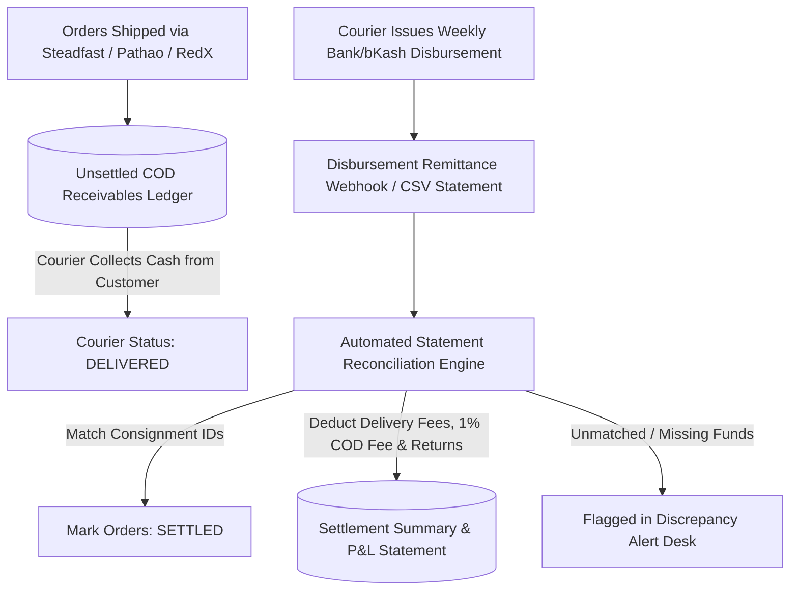
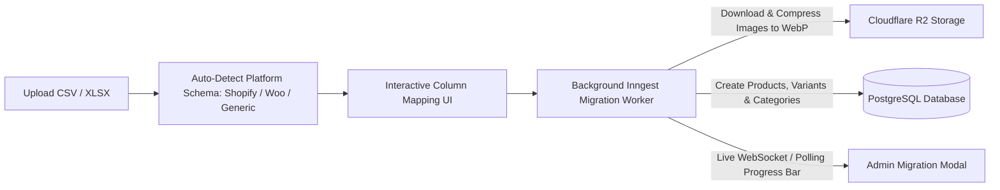

# Commercial Excellence: COD Reconciliation, 1-Screen Verification Desk & Accounting P&L Specification

Status: COMPLETE SPECIFICATION (COMMERCIAL & MARKET-FIT EXCELLENCE)  
Scope: `apps/admin`, `packages/core/src/accounting`, `packages/core/src/couriers`, `packages/db`

---

## 1. Executive Summary & Market Realities in Bangladesh

In Bangladeshi ecommerce, managing cash flow, courier receivables, manual order entry, and actual profit margins are the top pain points for merchants:
1. **The "Courier Black Box"**: Merchants ship ৳500,000 worth of COD orders a month across Steadfast, Pathao, and RedX, but struggle to know exactly how much money the couriers owe them, how much was deducted in 1% COD fees and return charges, and which bank/bKash disbursements have actually cleared.
2. **Order Verification Friction**: Staff waste 3–5 minutes per order jumping across 4 different tabs (bKash statement, fraud check, address validator, courier portal).
3. **F-Commerce Chat Orders**: Over 40% of sales happen via phone/chat, requiring a lightning-fast manual order entry screen.
4. **True Profit Blindness**: Gross sales look high, but when factoring in Cost of Goods Sold (COGS), return delivery penalties, and ad spend, merchants don't know their true net take-home profit.

This specification provides the production blueprint to solve these 9 commercial gaps.

---

## 2. COD Courier Settlement & Receivables Reconciliation Engine



### 2.1 Database Schema for COD Reconciliation

The models `CourierSettlementInvoice` and `CourierSettledOrder` and the `SettlementStatus` enum are defined once, in `docs/08-database-schema-and-rls-spec.md` (section 13), with two additions made during canvas alignment: `CourierSettledOrder.expectedNet` and `CourierSettledOrder.result` (`MATCHED`, `SHORT_PAID`, `MISSING`, `RETURNED`), and `Order.settlementStatus`. The canvas screens are `AdmCodRecon` (desktop) and `MobCodRecon` (mobile). Expenses for the P&L (`Expense`) are also in doc 08.

### 2.2 Merchant COD Receivables Dashboard (`/admin/finance/cod-reconciliation`)

Displays real-time financial tracking across all courier partners:
- **Total Unsettled COD**: ৳148,250 (Cash held by Steadfast ৳92,000, Pathao ৳41,250, RedX ৳15,000)
- **Settled This Month**: ৳432,100 disbursed across 6 weekly payout invoices
- **Total Courier Deductions**: ৳38,400 (Delivery ৳32,000, 1% COD Charge ৳4,320, Return penalties ৳2,080)
- **1-Click Statement Uploader**: Drag and drop Steadfast / Pathao CSV statements for auto-matching

---

## 3. One-Screen Order Verification & Dispatch Command Center

Instead of navigating multiple screens, the Order Detail page (`/admin/orders/[id]`) functions as a **Unified Verification Desk**:

```
┌──────────────────────────────────────────────────────────────────────────────────────────────────┐
│ [← Orders]  Order #ORD-10482  •  ৳2,450 (COD)  •  [Status: PENDING]         [⚡ 1-Click Book Courier] │
├────────────────────────────────┬────────────────────────────────┬────────────────────────────────┤
│ 👤 CUSTOMER & FRAUD TRUST      │ 📦 ITEMS & EDITABLE SUMMARY    │ 💳 PAYMENT & VERIFICATION      │
│                                │                                │                                │
│ Name:  Rahat Rahman            │ 1. Premium Panjabi (L / Black) │ Method: bKash Send Money       │
│ Phone: 01711223344 [📞 Call]   │    Qty: 1 • ৳1,450             │ TrxID:  9A8B7C6D5E             │
│        [💬 WhatsApp]           │ 2. Cotton Pajama (L / White)   │ Sender: 01819876543            │
│ Address: House 12, Road 5,     │    Qty: 1 • ৳900               │ Amount: ৳2,450                 │
│          Dhanmondi, Dhaka      │                                │                                │
│ Zone:  INSIDE_DHAKA (৳70)      │ Subtotal:       ৳2,350         │ [ ✅ Verify & Mark Paid ]      │
│                                │ Delivery:       ৳70            │ [ ❌ Flag Fake TrxID ]         │
│ 🛡️ TRUST SCORE: 88/100 (HIGH)  │ Total:          ৳2,420         │                                │
│  ✓ 14 of 15 Deliveries Success │ [ + Add / Swap Item ]          │ 🚚 COURIER SELECTION           │
│  ✓ Zero Doorstep Refusals      │                                │  (•) Steadfast (৳70 - Next Day)│
│                                │                                │  ( ) Pathao    (৳80 - Fast)    │
└────────────────────────────────┴────────────────────────────────┴────────────────────────────────┘
```

---

## 4. 15-Second Fast Manual & Chat Order Intake

For telephone and Facebook Messenger sales, staff hit `Alt + N` (or click `[+ Quick Order]`):

```typescript
// Fast Phone Lookup API Endpoint: /api/admin/customers/quick-lookup?phone=01711223344
// Returns existing customer name, addresses, and delivery trust score in < 20ms
```

1. **Auto-Complete**: Typing `01711...` instantly populates past address, preferred courier, and trust score.
2. **Product Chips**: Instant variant buttons (Size `M`, `L`, `XL`) with real-time stock counts.
3. **Instant Share Link**: Generates a pre-filled WhatsApp confirmation message with 1 click:
   *"প্রিয় রাহাত ভাই, আপনার অর্ডারের মোট বিল ৳২,৪৫০ (ক্যাশ অন ডেলিভারি)। অর্ডার কনফার্ম করতে বা ঠিকানা পরিবর্তন করতে ক্লিক করুন: https://rongdhonu.biztrack.bd/c/xK9p2L"*

---

## 5. Universal Merchant Migration Engine (CSV / Excel)

Merchants moving from WooCommerce, Shopify, StoreX, or custom Excel sheets can migrate in under 2 minutes:



---

## 6. Marketing Attribution Merchants Understand (Zero Double-Counting)

Instead of complex multi-touch attribution that confuses non-technical merchants, BizTrackBD provides **Last-Click Direct Attribution with Server-Side CAPI Reconciliation**:

| Channel | Orders | Gross Revenue (BDT) | Delivery Success Rate | Net Settled Revenue | Ad Spend (BDT) | Net ROAS |
|---|---|---|---|---|---|---|
| **Facebook Ads (Meta CAPI)** | 340 | ৳425,000 | 91.2% | ৳387,600 | ৳45,000 | **8.6x** |
| **WhatsApp Chat Links** | 120 | ৳168,000 | 96.5% | ৳162,120 | ৳0 (Organic) | **N/A** |
| **Direct / Search** | 85 | ৳112,000 | 94.1% | ৳105,392 | ৳0 (Organic) | **N/A** |
| **TikTok Ads** | 45 | ৳54,000 | 82.2% | ৳44,388 | ৳9,500 | **4.6x** |

---

## 7. Executive Net Profit & P&L Accounting Engine

Under `/admin/analytics/profit-loss`:

$$\mathbf{Net\ Profit} = \mathbf{Gross\ Sales} - \mathbf{COGS} - \mathbf{Delivery\ Deductions} - \mathbf{Return\ Penalties} - \mathbf{Gateway\ Fees} - \mathbf{Ad\ Spend}$$

### Real-Time Financial Statement Example (October 2026):

```
============================================================
BIZTRACKBD EXECUTIVE FINANCIAL STATEMENT: RONGDHONU FASHION
============================================================
(+) Gross Delivered Sales (520 Orders):           ৳ 742,000.00
(-) Cost of Goods Sold (COGS):                   -৳ 326,480.00
------------------------------------------------------------
(=) Gross Merchandise Margin:                     ৳ 415,520.00 (56.0%)

(-) Courier Shipping Deductions (Steadfast/Pathao): -৳  39,200.00
(-) Courier 1% COD Service Fee + VAT:             -৳   7,420.00
(-) Doorstep Return Losses (32 Returned Parcels): -৳   4,160.00
(-) MFS / Gateway Processing Fees (SSLCommerz):   -৳   3,250.00
(-) Meta Ad Spend (Tracked via Pixel/CAPI):       -৳  52,000.00
------------------------------------------------------------
(=) NET TAKE-HOME MERCHANT PROFIT:                ৳ 309,490.00 (41.7%)
============================================================
```

---

## 8. As built (Phase 4)

- **Expected payout** per delivered cash-on-delivery parcel: cash collected, minus the courier's delivery charge (the real figure if the courier told us at booking or on a statement; else the store's rate for inside or outside Dhaka), minus the COD fee (store's percentage of the cash). The rates are `StoreSettings.courierFeeInsideDhaka`, `courierFeeOutsideDhaka`, `courierCodFeePercent` (defaults 70, 130, 1) and are edited under Delivery charges. They are the owner's cost, not the customer's delivery charge.
- **Statement import:** a CSV chosen in the browser. Columns are found by name (consignment ID, invoice or order number, COD amount, delivery charge, COD charge, return charge, payable, status), a title line above the header is tolerated, and a missing payable column is worked out from the others. Parcels are matched for that one courier only. A line is `MATCHED`, `SHORT_PAID` (paid more than ৳1 below expected) or `RETURNED` (the courier's return charge is recorded and nothing is compared). Rows for parcels not found, or already on another statement, are reported and skipped. The payout invoice number is unique per courier. `Order.settlementStatus` follows: matched and returned become `SETTLED`, short-paid `DISCREPANCY_FLAGGED`, still-owed ones stay `COLLECTED_UNSETTLED`. `MISSING` is shown as "Not paid yet" (a delivered parcel with no statement line), flagged overdue after 7 days.
- **Profit lines,** each landing on the day it happened: delivered sales (by `deliveredAt`, Bangladesh time); cost of goods (item cost snapshot, else the product's cost price now); courier delivery and COD fees (statement figures where imported, else estimated and counted as "estimated parcels"); return losses (the trip's charge for parcels that came back); refunds paid by bKash or Nagad (store credit is not cash out until spent); gateway fees (zero until the card gateway ships; manual bKash and Nagad have none); and the owner's expenses by category. Sums are in whole paisa, so net profit is exactly sales minus the lines, and the daily figures add up to the headline.
- **Not built:** channel attribution and ROAS (needs Phase 6 pixels), bulk migration from other platforms (section 5), the one-screen desk's "swap item" and the bKash statement lookup.
