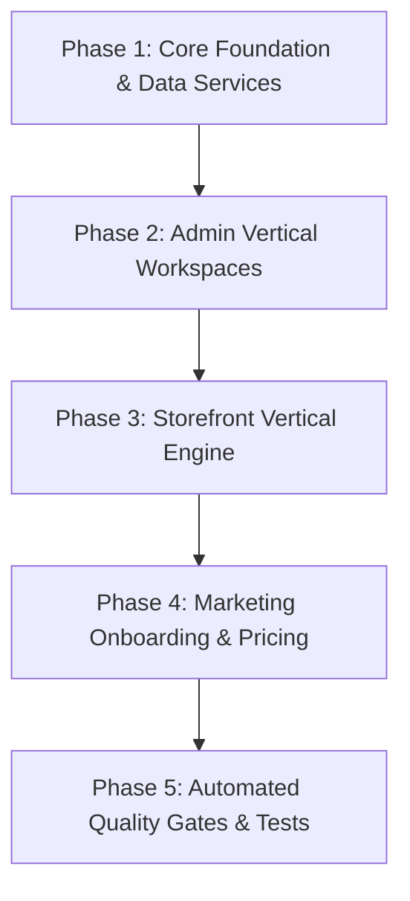

# BizTrack Business — Session Wrap-up & Tomorrow's Execution Plan

**Document Number:** 52  
**Date:** 16 October 2026  
**Status:** Approved & Ready for Execution  

---

## 1. Today's Achievements & Production Fixes

### 1.1 Marketing Homepage Production Crash Fixed (React Error #441)
- **Root Cause:** Next.js Server Components in `apps/marketing/src/app/layout.tsx` were calling `getPlatformSeoConfig()`, which called `getPlatformPrisma()`. In production, the Vercel Marketing deployment was provisioned with `DATABASE_URL` (app session pooler) but lacked `PLATFORM_DATABASE_URL`. Because `getPlatformSeoConfig()` had no `try/catch`, it threw an unhandled exception during SSR, aborting the React Server Component stream with `Uncaught Error: Minified React error #441`.
- **Code Hardening Applied:**
  - `packages/db/src/client.ts`: `getPlatformPrisma()` now falls back to `process.env.DIRECT_URL || process.env.DATABASE_URL` if `PLATFORM_DATABASE_URL` is omitted.
  - `packages/core/src/platform/config.ts`: `getPlatformSeoConfig()` now catches database lookup errors and gracefully returns curated default SEO metadata.
  - `apps/marketing/src/app/layout.tsx`: `generateMetadata()` and `RootLayout` now safely catch errors so page rendering never crashes.
  - `packages/core/src/platform/billing.ts` & `apps/marketing/src/app/pricing/page.tsx`: Added defensive fallback plans in `listPublicPlans()` ensuring pricing sections always render even during DB latency.
- **Favicon 404 Resolved:** Generated brand-authentic 32×32 purple `#5B4FE8` `favicon.ico` files for `apps/marketing`, `apps/storefront`, and `apps/admin`, linked in HTML metadata.
- **Git Commit:** Committed and pushed to `main` as [`e9db2f1`](https://github.com/neiloy-neil/biztrackbd-ecom/commit/e9db2f1). Verified clean Turbopack build and TypeScript typecheck.

---

## 2. Finalized Grill-Me Architectural Decisions

Through the comprehensive `/grill-me` alignment session, all 8 major design branches were resolved and locked:

1. **Implementation Sequencing: Foundation-First**
   - Implement data models and core CRUD services first, followed by Admin contextual workspaces, Storefront vertical layout bindings, and Marketing onboarding.
2. **Admin Structured Content UX: Contextual Sidebar Navigation**
   - Provide top-level vertical links in the Admin sidebar (`/services`, `/team`, `/portfolio`, `/downloads`) loading a shared, high-productivity CRUD manager filtered to that item kind.
3. **Digital Asset Downloads: Configurable Lead Gate**
   - Each download asset has a merchant toggle: *"Require visitor contact before download"* (Lead Magnet mode) vs *"Direct 1-click download"*.
4. **Content Import Assistant: Onboarding & Settings Placement**
   - Available during initial setup and anytime in `Admin -> Settings -> Import Content` with an interactive checklist before applying to site profile and pages.
5. **Admin Command Center Home (`/`): Mode-Adaptive Layout**
   - Automatically adapts based on `siteMode`:
     - `PORTFOLIO`: Displays Lead & Booking metrics, WhatsApp CTA telemetry, and direct follow-up links.
     - `ECOMMERCE`: Displays sales, orders, and courier fulfillment cards.
     - `HYBRID`: Displays a tabbed toggle between Website Performance and Sales Ledger.
6. **Marketing Pricing Page (`/pricing`): Tabbed Segmented Switcher**
   - A prominent segmented toggle at the top of the pricing page (*"Online Store Plans"* vs *"Business Website & Portfolio Plans"*).
7. **Onboarding Wizard (`/start`): Smart Mode Step + Deep Linking**
   - Starts with *"What are you building?"* (Online Store vs Business Website vs Hybrid) and honors deep-link URL params (e.g. `/start?mode=portfolio&vertical=restaurant`).
8. **Storefront Home Page Fallback: Automatic Vertical Starter Manifest**
   - When no custom home layout has been published yet, Portfolio tenants automatically render the curated section layout of their selected starter template (e.g. Dhaka Bistro for restaurants, Modern Clinic for doctors) rather than empty product shelves.
9. **Quality Gate Cadence: Continuous Milestone Verification**
   - Run typecheck and automated tests after each phase to guarantee zero regressions at every step.

---

## 3. Tomorrow's Step-by-Step Execution Plan

### Phase 1: Core Foundation & Data Layer
- **Target Files:**
  - `packages/core/src/site/content-items.ts` (CRUD for `SiteContentItem`: services, team, portfolio, credentials).
  - `packages/core/src/site/downloads.ts` (CRUD and tracking for `SiteDownload`).
  - `packages/core/src/index.ts` (Export new services).
- **Quality Gate:** `pnpm --filter @biztrackbd/core run typecheck` passes with 0 errors.

### Phase 2: Admin Vertical Workspaces
- **Target Files:**
  - `apps/admin/src/app/(admin)/layout.tsx` (Add contextual vertical navigation links).
  - `apps/admin/src/app/(admin)/content-items/` (Create shared contextual CRUD manager for services, team, portfolio, credentials).
  - `apps/admin/src/app/(admin)/downloads/` (Create download asset manager with lead gate toggle).
  - `apps/admin/src/app/(admin)/page.tsx` & `dashboard-operations-client.tsx` (Mode-adaptive dashboard for Portfolio/Hybrid).
  - `apps/admin/src/app/(admin)/settings/import/` (Smart text paste & site fetcher assistant).
- **Quality Gate:** `pnpm --filter @biztrackbd/admin run typecheck` passes with 0 errors.

### Phase 3: Storefront Vertical Engine
- **Target Files:**
  - `apps/storefront/src/app/(store)/page.tsx` (Fallback to vertical template manifest for unedited portfolio homepages).
  - `apps/storefront/src/app/api/downloads/[id]/route.ts` (Direct vs gated download delivery & lead logging).
  - `apps/storefront/src/app/(store)/layout.tsx` (Schema.org JSON-LD vertical injections: `Restaurant`, `Physician`, `LocalBusiness`, `Person`).
- **Quality Gate:** `pnpm --filter @biztrackbd/storefront run typecheck` passes with 0 errors.

### Phase 4: Marketing Onboarding & Pricing
- **Target Files:**
  - `apps/marketing/src/app/pricing/page.tsx` (Tabbed segmented switcher for store vs website plans).
  - `apps/marketing/src/app/start/wizard.tsx` (3-step onboarding wizard with smart mode selection).
- **Quality Gate:** `pnpm --filter @biztrackbd/marketing run typecheck` passes with 0 errors.

### Phase 5: Automated Quality Gates & Tests
- **Target Files:**
  - `packages/core/tests/biztrack-business.test.ts` (RLS tenant isolation, plan limits, anti-bot minimum time, CSV formula neutralization).
- **Quality Gate:** Full build pass across all workspaces: `pnpm build`.

---

## 4. Current Repository State
- **Branch:** `main` (clean, up to date with `origin/main`).
- **Latest Commit:** `e9db2f1` (`fix(marketing): resolve RSC error #441 on homepage, add DB fallbacks, and add brand favicon`).
- **All Active Documents:** Verified and aligned.

---

## 5. Completed Feature: Digital Table Menu & QR Ordering Experience

### 5.1 Architecture & Components
- **Core QR & Order Engine (`packages/core/src/site/qr.ts`):**
  - `generateBatchTableQrs(options)`: Generates high-res PNG and vector SVG QR codes for sequential table ranges (1–100) and custom labels (`VIP-1`, `Roof-A`).
  - `parseCustomTableLabels(input)`: Parses and sanitizes comma/newline separated table names.
  - `formatTableOrderMessage(options)`: Generates structured, bilingual WhatsApp tickets with dish quantities, pricing breakdown, total ৳ bill, and special kitchen notes.
- **Storefront Dedicated Mobile Dining Route (`apps/storefront/src/app/(store)/menu/`):**
  - Dedicated `/menu` route honoring `?table=N` query parameter with auto-fallback to takeaway mode.
  - Dynamic category switching, dietary pills (`Halal`, `Chef's Special`, `Spicy`, `Vegetarian`), and instant dish search.
  - Interactive Table Tray with slide-up drawer, special notes, and 1-tap WhatsApp order dispatch.
  - 1-tap `Call Waiter / বিল দিন` quick assistance button.
- **Admin Table QR Studio (`apps/admin/src/app/(admin)/menu/`):**
  - Tabbed switcher in Menu Manager: `[🍽️ Menu Categories & Dishes]` and `[📱 Table QR Studio]`.
  - Dual preset formats: **A6 Acrylic Stand Card** (2 per A4 sheet) and **Compact Square Sticker** (6 per A4 sheet).
  - Live preview with restaurant logo, table badge, bilingual call-to-action, and optional guest WiFi credentials.
  - `@media print` optimized CSS with dashed cutting guides.
  - Batch SVG/PNG export and 1-click browser printing.
- **Automated Verification:**
  - 100% test pass in `packages/core/tests/site-menu-qr.test.ts` (13 tests), `security.test.ts` (10 tests), and `biztrack-business.test.ts` (17 tests).
  - Clean TypeScript typecheck across `@biztrackbd/core`, `@biztrackbd/admin`, and `@biztrackbd/storefront`.

---

## 6. Completed Feature: End-to-End Business Demo System & Fast-Track Onboarding

### 6.1 Architecture & Verticals
- **5 Dedicated Business Demo Verticals (`packages/core/src/demo/business-templates.ts`):**
  1. `dhaka-bistro` (Host: `dhakabistro`, Vertical: `RESTAURANT`): Multi-course Bengali & Mughal cuisine, halal-certified dining, active table QR ordering, chef specials.
  2. `modern-clinic` (Host: `modernclinic`, Vertical: `DOCTOR_CLINIC`): Dual-chamber consultation, BMDC doctor credentials, teleconsultation & in-person appointments, patient FAQs.
  3. `apex-corporate` (Host: `apexcorp` / alias `corporate-trust`, Vertical: `BUSINESS_COMPANY`): Enterprise advisory & compliance, leadership bios, client case studies, corporate brochure download.
  4. `local-service-pro` (Host: `localservice`, Vertical: `SERVICE_PROVIDER`): Transparent home appliance & AC repair tiers, 24/7 emergency dispatch, certified technicians, authentic reviews.
  5. `portfolio-focus` (Host: `creativefolio`, Vertical: `PERSONAL_PORTFOLIO`): UI/UX designer & brand strategist portfolio, high-impact case studies, bilingual CV download, calendar booking.

### 6.2 Data Seeding Engine (`packages/core/src/demo/business-seed.ts`)
- `seedBusinessDemoStore(tenantId, templateSlug)`: Programmatically seeds store settings, theme installation, menu categories & dishes, structured content items (doctors, services, case studies, team), and digital asset downloads.
- Integrated into `packages/core/src/platform/signup.ts` so portfolio merchants opting into demo data immediately receive authentic Bangladeshi content on signup.

### 6.3 Marketing Template Gallery (`apps/marketing/src/components/template-gallery.tsx`)
- **Top Primary Segmented Switcher:** Toggle smoothly between `[🛍️ Online Storefronts]` (eCommerce themes) and `[🏢 Business & Service Websites]` (Business verticals).
- **Interactive Responsive Viewport Modal Previewer:**
  - Viewport switcher: Desktop (100%), Tablet (768px), and Mobile (375px) with device frames and simulation status indicators.
  - Deep-linkable "Start with this template" CTA leading directly to `/start?template=X`.
  - Direct popout to preview in new tab.
- **Routing & Aliasing (`apps/marketing/src/app/demo/[template]/page.tsx`):**
  - Instant redirect to business demo subdomains or paths for both e-commerce and business demo templates.

### 6.4 Storefront Demo Ribbon & Fast-Track Onboarding
- **Storefront Demo Ribbon (`apps/storefront/src/components/demo-ribbon.tsx`):**
  - Detects `siteMode` and `vertical` dynamically.
  - Displays tailored simulation notice (e.g. *"This is an interactive demo of our Dhaka Bistro restaurant template. Orders and appointments placed here are simulated."*).
  - Deep links to `/start?template=X&mode=portfolio` to quickly replicate the demo.
- **Fast-Track Onboarding (`apps/marketing/src/app/start/`):**
  - Recognizes `wantedTemplate` param, auto-locking `siteMode="PORTFOLIO"`, pre-selecting the vertical, and auto-checking the demo data seeding toggle.

### 6.5 Quality Verification
- 100% test pass in `packages/core/tests/business-templates.test.ts` (7 tests), `security.test.ts` (10 tests), and `site-menu-qr.test.ts` (13 tests).
- 0 TypeScript compilation errors across `@biztrackbd/core`, `@biztrackbd/marketing`, and `@biztrackbd/storefront`.

